# Skenario Pengujian Surkem (Milestone 2)

Dokumen ini terpisah dari materi praktikum dan menjadi lembar pencatatan pengujian
fitur Surkem. Jalankan seluruh skenario dengan data sintetis saja. Isi kolom **Hasil
aktual** dan **Status** setelah skenario benar-benar dijalankan; jangan menandai
skenario lulus sebelum hasilnya diverifikasi.

## Data uji

Gunakan nama dan kontak yang dibuat khusus untuk pengujian, misalnya `Warga Uji
Surkem`, nomor telepon dummy yang valid untuk batasan aplikasi, serta identitas
dummy 16 digit. Jangan gunakan NIK, nomor telepon, atau informasi pribadi nyata.
Untuk pengujian penghapusan, buat data khusus agar tidak menghapus data lain.

Data Warga 
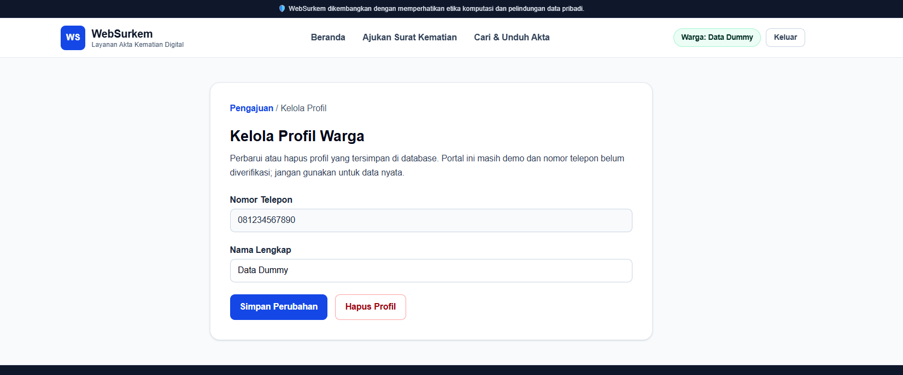
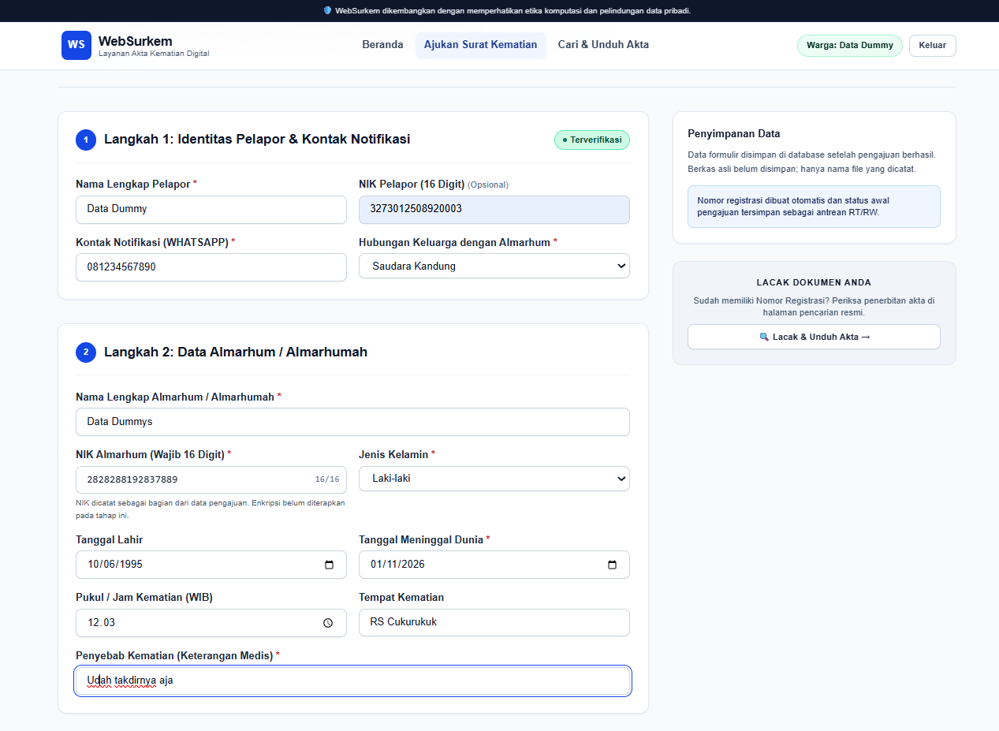
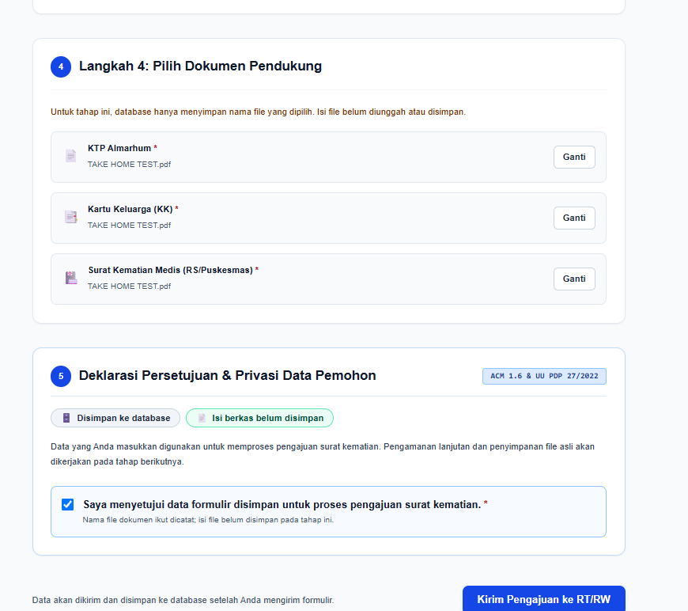

## Skenario CRUD dan relasi

| ID | Jenis | Tujuan | Langkah pengujian | Hasil yang diharapkan | Hasil aktual | Status |
|---|---|---|---|---|---|---|
| P-01 | Create profil | Membuat profil warga baru. | Buka `/login-warga`; isi nama serta nomor telepon sintetis yang belum terdaftar; setujui penyimpanan; kirim formulir. | Profil muncul di database `WargaProfile` dan pengguna diarahkan ke alur pengajuan. | Sudah diuji |  |
| P-02 | Read profil | Membaca profil yang sudah tersimpan. | Buka `/profil-warga` menggunakan sesi dari profil yang dibuat pada P-01. | Nama dan nomor telepon yang dimuat cocok dengan baris profil di database. | Sudah diuji. |  |
| P-03 | Update profil | Memperbarui nama profil warga. | Di `/profil-warga`, ubah nama menjadi nama sintetis lain lalu simpan; muat ulang halaman. | Nama baru tampil setelah dimuat ulang dan nilainya berubah pada database. | Sudah Diuji | 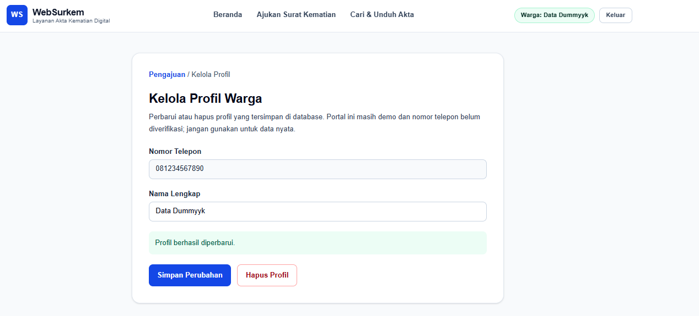 |
| P-04 | Delete profil | Menghapus profil warga. | Hapus profil uji di `/profil-warga` dan konfirmasi tindakan. | Baris profil terhapus dari `WargaProfile` dan sesi warga berakhir. | Belum diuji. | 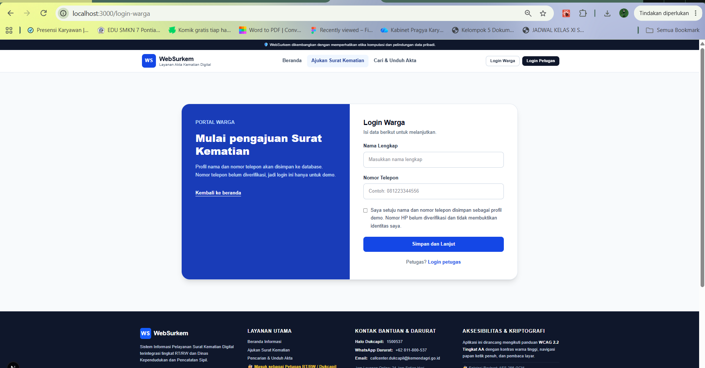 | --> 
| A-01 | Create pengajuan | Membuat pengajuan surat kematian. | Isi `/pengajuan` dengan data peristiwa dan nama berkas sintetis yang valid, setujui pemrosesan, lalu kirim. | Pengajuan dengan nomor registrasi baru tersimpan di `DeathReport` dan bukti pengajuan ditampilkan. | Sudah Diuji |  |
| A-02 | Read pengajuan | Membaca daftar dan detail pengajuan. | Buka dashboard petugas, cari nomor registrasi uji, lalu buka detailnya. | Daftar dan detail menampilkan data yang sama dengan pengajuan tersimpan di database. | Sudah teruji | 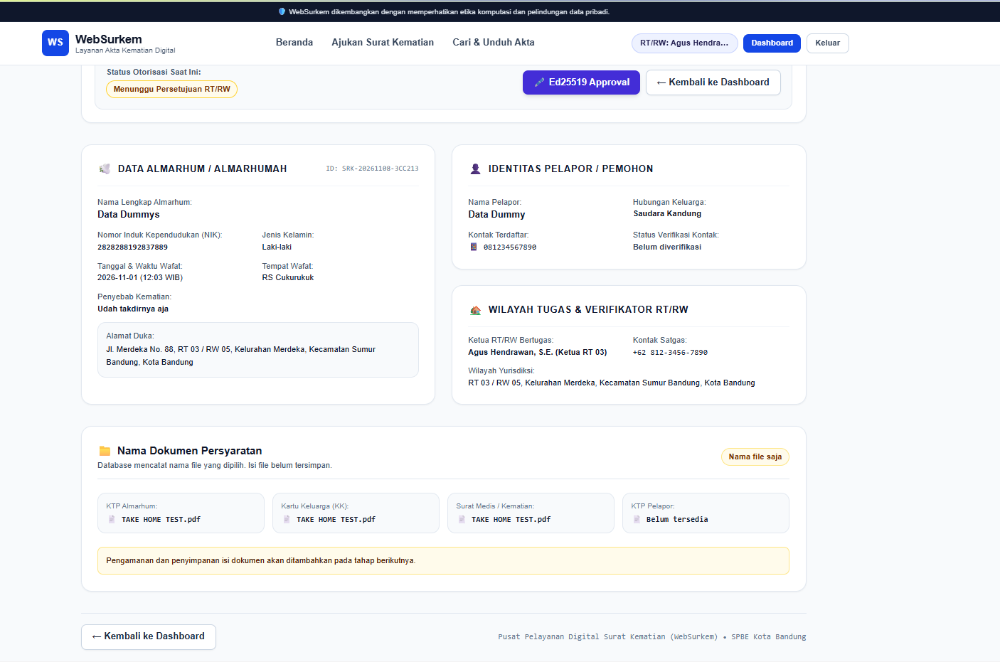 |
| A-03 | Update pengajuan | Memperbarui status pengajuan melalui alur produk. | Gunakan tindakan persetujuan/status yang tersedia pada dashboard untuk pengajuan uji. | Status baru tersimpan di `DeathReport` dan ditampilkan konsisten pada daftar/detail setelah dimuat ulang. | Sudah teruji | 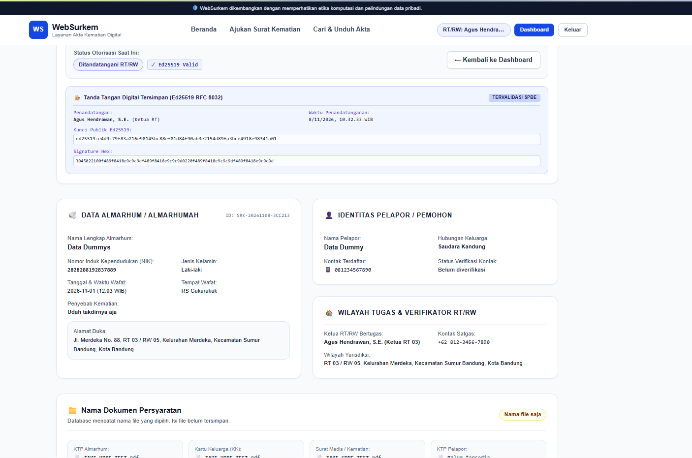 |
| A-04 | Delete pengajuan | Menghapus pengajuan uji. | Hapus pengajuan sintetis melalui dashboard dan setujui konfirmasi. | Pengajuan tidak lagi ada di daftar dan baris terkait terhapus dari `DeathReport`. | Sudah teruji |  | 
| R-01 | Relasi profil-pengajuan | Memastikan pengajuan terhubung ke profil warga. | Buat profil terlebih dahulu; kirim pengajuan dengan metode WhatsApp dan nomor yang sama; periksa `reporterProfileId` pada database. | `DeathReport.reporterProfileId` menunjuk ke ID `WargaProfile` yang sesuai. | Sudah teruji | 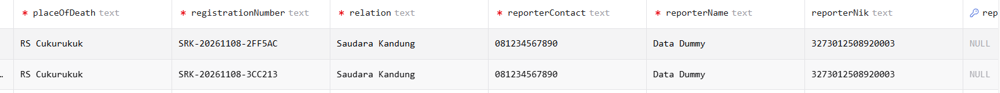 |
| R-02 | Relasi saat hapus profil | Memastikan pengajuan tetap ada saat profil terkait dihapus. | Gunakan profil yang memiliki pengajuan dari R-01; hapus profil; periksa profil dan pengajuan di database. | Profil terhapus, pengajuan tetap ada, dan `reporterProfileId` menjadi `NULL` sesuai `onDelete: SetNull`. | Sudah teruji | 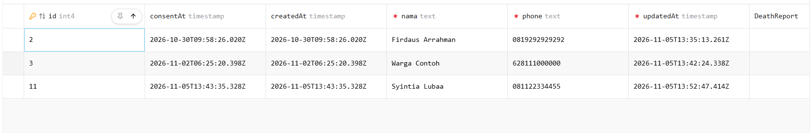 | 

## Skenario validasi server

Tiga skenario berikut menjadi bukti penolakan input tidak valid. Untuk setiap
skenario, pastikan pesan kesalahan terlihat pada field terkait dan data invalid
tidak tersimpan.

| ID | Field yang diuji | Langkah pengujian | Hasil yang diharapkan | Hasil aktual | Status |
|---|---|---|---|---|---|
| V-01 | Nama profil | Kirim formulir dengan nama yang hanya berisi spasi serta nomor telepon sintetis yang valid. | Server menolak data setelah normalisasi; pesan validasi nama tampil pada field nama dan profil tidak dibuat. | Sudah teruji |  |
| V-02 | Nama profil | Kirim formulir dengan nama dua karakter serta nomor telepon sintetis yang valid. | Server menolak data; pesan bahwa nama minimal 3 karakter tampil pada field nama dan profil tidak dibuat. | Sudah teruji | 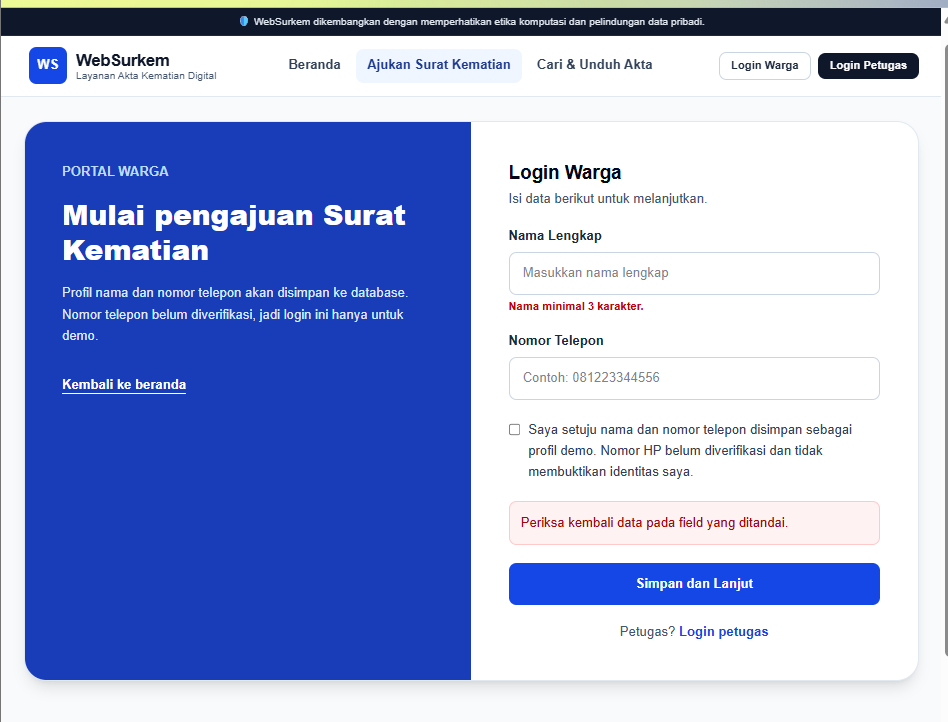 |
| V-03 | Nomor telepon profil | Kirim nama valid dan nomor telepon sintetis 16 digit. | Server menolak data; pesan bahwa nomor telepon harus terdiri dari 8–15 digit tampil pada field telepon dan profil tidak dibuat. | Sudah teruji | 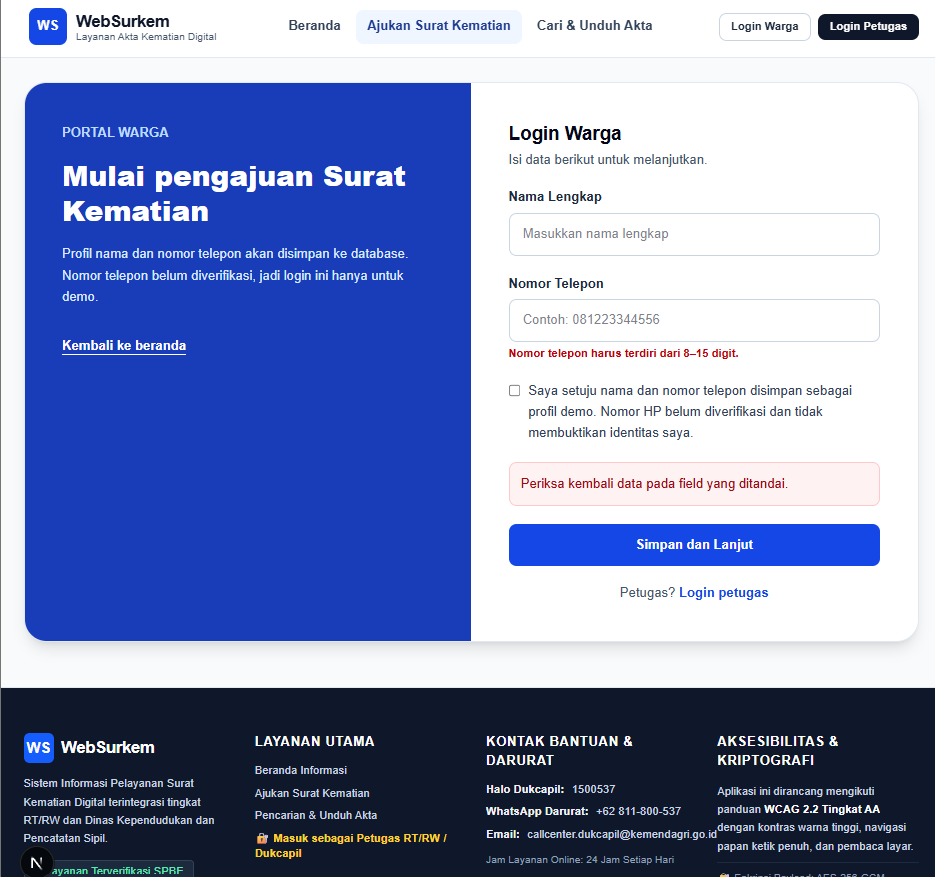 |

## Rekap dan bukti

Jumlah skenario: **13** (8 CRUD, 2 relasi, 3 validasi server). Minimal **12 dari
13** skenario harus berstatus lulus untuk memenuhi ambang keberhasilan 90% yang
dibulatkan ke atas.

Setelah pengujian:

- Ganti setiap nilai “Belum diuji” pada kolom hasil aktual dengan hasil yang
  benar-benar diamati, termasuk bila hasilnya berbeda dari harapan.
- Ubah status menjadi **Lulus** atau **Gagal** berdasarkan hasil aktual dan
  verifikasi database.
- Ambil tangkapan layar untuk bukti alur CRUD/integrasi database dan masing-masing
  dari tiga penolakan validasi server.
- Untuk operasi create, update, dan delete, verifikasi perubahan pada PostgreSQL
  menggunakan Prisma Studio atau query database. Jangan sertakan data pribadi nyata
  pada tangkapan layar.

## Skenario kriptografi data NIK

Pengujian berikut memakai NIK sintetis. Jalankan dengan `npm test` dari folder
`backend`; kunci uji dibuat acak selama proses pengujian dan tidak disimpan.
Untuk database yang sudah berisi data sebelum enkripsi ini, jalankan
`npm run db:encrypt-existing` dari folder `backend` setelah mengatur
`ENCRYPTION_KEY_BASE64` pada environment proses backend atau secret manager di
luar repository.

| ID | Jenis | Tujuan | Hasil yang diharapkan | Hasil aktual | Status |
|---|---|---|---|---|---|
| K-01 | Enkripsi/dekripsi | Memastikan NIK dapat dienkripsi lalu dipulihkan dengan kunci dan AAD yang benar. | Hasil dekripsi sama dengan NIK sintetis; nilai tersimpan berbeda dari plaintext. | Lulus: tercakup dalam `backend/test/sensitive-data.test.js`. | Lulus |
| K-02 | Nonce | Memastikan setiap enkripsi menggunakan nonce baru. | Dua enkripsi nilai sama menghasilkan nonce dan envelope berbeda. | Lulus: nonce dibandingkan pada pengujian otomatis. | Lulus |
| K-03 | AAD | Memastikan ciphertext dapat dibaca dengan konteks field yang benar. | Dekripsi berhasil dengan AAD field yang sesuai. | Lulus: tercakup dalam pengujian otomatis. | Lulus |
| K-04 | Integritas ciphertext | Memastikan data yang dimodifikasi ditolak. | Dekripsi gagal saat ciphertext berubah. | Lulus: pengujian otomatis memastikan dekripsi melempar galat. | Lulus |
| K-05 | Integritas tag | Memastikan tag autentikasi yang dimodifikasi ditolak. | Dekripsi gagal saat tag berubah. | Lulus: pengujian otomatis memastikan dekripsi melempar galat. | Lulus |
| K-06 | Kunci dan AAD salah | Memastikan kunci salah atau konteks field berbeda tidak diterima. | Kedua percobaan dekripsi gagal tanpa mengembalikan plaintext. | Lulus: pengujian otomatis memastikan kedua percobaan melempar galat. | Lulus |
| K-07 | Validasi kunci | Memastikan konfigurasi kunci kosong atau panjangnya salah ditolak. | Kunci tidak valid menghasilkan kegagalan konfigurasi. | Lulus: pengujian otomatis memastikan kedua bentuk kunci ditolak. | Lulus |

## Demonstrasi
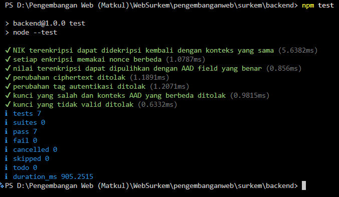
Melindungi NIK pelaor dan almarhum yang disimpan pada pengajuan menggunakan AES-256-GCM. AES-GCM dipilih karena memberikan kerahasiaan sekaligus memeriksa integritas data. Jika ciphertext atau tag diubah, atau kuncinya salah, data tidak bisa didekripsi.

Kuncinya berukuran 32 byte dan dibuat menggunakan CSPRNG. Kunci dibaca dari environment variable ENCRYPTION_KEY_BASE64, bukan ditulis di kode atau disimpan di repository. Setiap enkripsi memakai nonce acak 12 byte. AAD berisi nama field, sehingga data NIK pelapor tidak bisa begitu saja dipindahkan menjadi NIK almarhum. Tag autentikasinya 16 byte.

Saya menjalankan npm test. Tujuh tes lulus, termasuk tes bahwa perubahan data, perubahan tag, kunci salah, dan konfigurasi kunci yang tidak valid ditolak. Tes ini membuktikan perilaku fungsi enkripsinya.

Pada aplikasi, backend mendekripsi NIK hanya setelah autentikasi berhasil, jadi data yang ditampilkan tetap terbaca. Untuk membuktikan penyimpanan di database, saya akan menunjukkan data uji sintetis di tabel DeathReport; nilai yang tersimpan seharusnya diawali v1..”