# Dokumen Teknis Modul 6 — PostgreSQL dan Prisma ORM

Nama/NIM: Alifa Fatin Ramadhani  
Repositori: <https://github.com/alifafatin/PraktikumPAW.git>

## 1. Rancangan Data

### Diagram entitas dan relasi

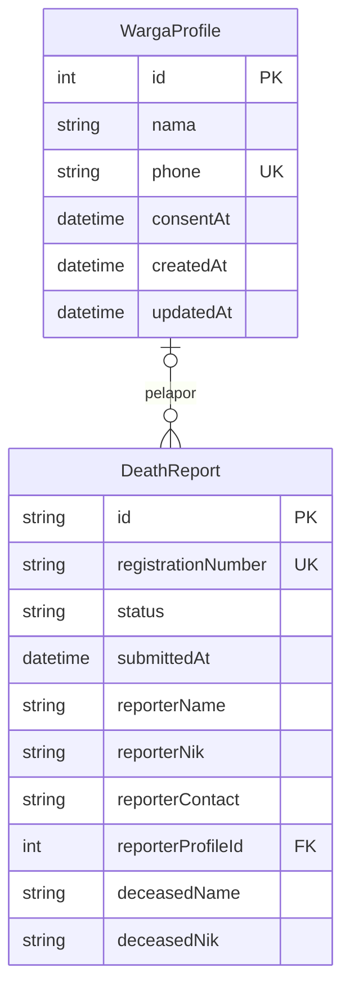

Satu `WargaProfile` dapat terkait dengan nol atau banyak `DeathReport`. Setiap
`DeathReport` terkait dengan nol atau satu profil karena `reporterProfileId`
bersifat opsional (`Int?`). Contohnya, laporan yang dibuat memakai email tidak
harus mempunyai profil warga berbasis nomor telepon.

### Kunci dan constraint

- `WargaProfile.id`: primary key integer yang dibuat otomatis.
- `WargaProfile.phone`: unique; satu nomor telepon hanya memiliki satu profil.
- `DeathReport.id`: primary key string yang dibuat dengan `cuid()`.
- `DeathReport.registrationNumber`: unique; nomor registrasi laporan tidak boleh
  berulang.
- `DeathReport.reporterProfileId`: foreign key opsional ke `WargaProfile.id`.
- Index tambahan: `DeathReport.submittedAt`, `DeathReport.status`, dan
  `DeathReport.reporterProfileId`.

### Alasan aturan `onDelete`

Relasi menggunakan `onDelete: SetNull` dan `onUpdate: Cascade`. Jika profil warga
dihapus, laporan kematian tetap disimpan dan hanya `reporterProfileId` yang
menjadi `NULL`. Ini mempertahankan riwayat laporan. `Cascade` pada perubahan ID
menjaga foreign key tetap menunjuk ke profil yang benar.

**Catatan kesesuaian instruksi:** skema aplikasi saat ini memakai `SetNull`, bukan
`Restrict`. Demonstrasi `Restrict` pada bagian 5 menggunakan tabel sementara
terpisah agar tidak mengubah aturan atau data aplikasi.

## 2. Skema dan Migrasi

### Lokasi dan isi skema

Skema lengkap berada di [`backend/prisma/schema.prisma`](../../backend/prisma/schema.prisma).
Berikut model-model inti yang berelasi:

```prisma
model WargaProfile {
  id           Int           @id @default(autoincrement())
  nama         String
  phone        String        @unique
  consentAt    DateTime      @default(now())
  createdAt    DateTime      @default(now())
  updatedAt    DateTime      @updatedAt
  deathReports DeathReport[]
}

model DeathReport {
  id                 String        @id @default(cuid())
  registrationNumber String        @unique
  status             String        @default("AWAITING_RTRW_APPROVAL")
  submittedAt        DateTime      @default(now())
  consentAt          DateTime      @default(now())
  reporterName       String
  reporterNik        String?
  reporterContact    String
  reporterProfileId  Int?
  reporterProfile    WargaProfile? @relation(
    fields: [reporterProfileId],
    references: [id],
    onDelete: SetNull
  )
  authMethod         String
  relation           String
  deceasedName       String
  deceasedNik        String
  gender             String
  dateOfBirth        String?
  dateOfDeath        String
  timeOfDeath        String
  placeOfDeath       String
  causeOfDeath       String
  address            String
  rt                 String
  rw                 String
  kelurahan          String
  kecamatan          String
  city               String
  assignedRTRW       Json
  documentNames      Json
  rtRwSignature      Json?
  dukcapilIssuance   Json?
  notes              String?

  @@index([submittedAt])
  @@index([status])
  @@index([reporterProfileId])
}
```

Model `User` juga ada untuk akun email dan password; saat ini model tersebut tidak
berelasi dengan `WargaProfile` atau `DeathReport`.

### Migration

Folder migration yang tersedia:

```text
backend/prisma/migrations/
├── 20261030085447_init/
├── 20261030100000_user_auth/
├── 20261030110000_warga_profile/
├── 20261101200000_death_report/
└── 20261102100000_reporter_profile_relation/
```

Migration relasi terakhir menambahkan foreign key dan index berikut:

```sql
ALTER TABLE "DeathReport"
ADD COLUMN "reporterProfileId" INTEGER;

CREATE INDEX "DeathReport_reporterProfileId_idx"
ON "DeathReport"("reporterProfileId");

ALTER TABLE "DeathReport"
ADD CONSTRAINT "DeathReport_reporterProfileId_fkey"
FOREIGN KEY ("reporterProfileId") REFERENCES "WargaProfile"("id")
ON DELETE SET NULL ON UPDATE CASCADE;
```

Jalankan perintah dari folder `backend`:

```powershell
npx prisma validate
npm run db:generate
npm run db:migrate
```

Setelah terhubung ke database yang sama dengan `DATABASE_URL`, jalankan di `psql`:

```sql
\d "WargaProfile"
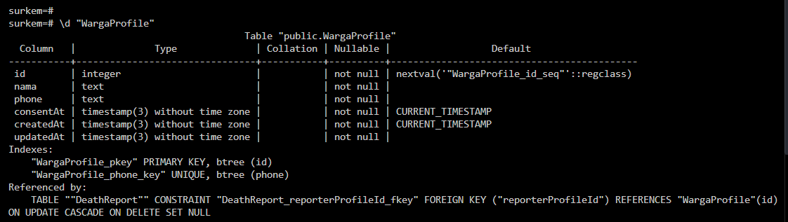
\d "DeathReport"
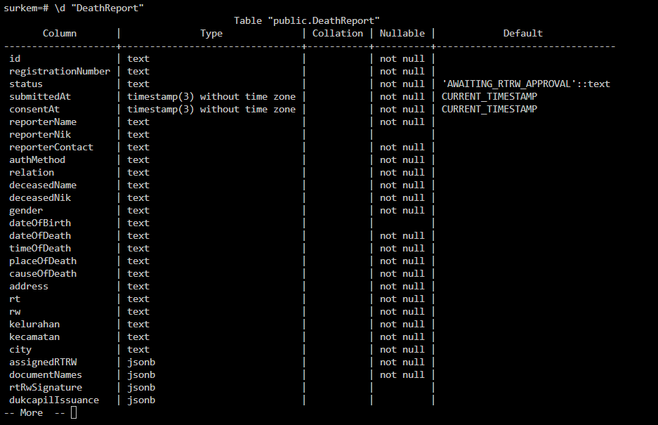

## 3. Seed dan Prisma Client

Seed berada di [`backend/prisma/seed.js`](../../backend/prisma/seed.js).
Konfigurasi perintah seed ada di [`backend/prisma.config.ts`](../../backend/prisma.config.ts):

```ts
migrations: {
  path: "prisma/migrations",
  seed: "node prisma/seed.js",
},
```

Seed membuat/memperbarui profil contoh dengan nomor `628111000000` dan laporan
`SRK-SEED-2026-001`. Operasi `upsert` membuat seed idempotent untuk kedua nilai
unik tersebut: menjalankannya kembali memperbarui record yang sama, bukan
membuat duplikat.

Jalankan dua kali dari folder `backend`:

```powershell
npx prisma db seed
npx prisma db seed
```

Verifikasi jumlah record:

```sql
SELECT count(*)
FROM "WargaProfile"
WHERE "phone" = '628111000000';

SELECT count(*)
FROM "DeathReport"
WHERE "registrationNumber" = 'SRK-SEED-2026-001';
```

Jumlah masing-masing diharapkan `1`.

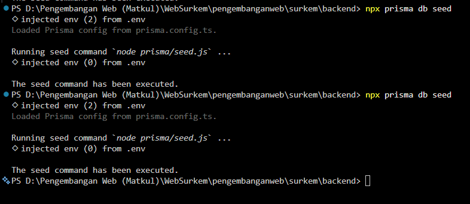


Seed tidak mengimpor `lib/prisma.ts` karena seed adalah proses mandiri yang
dijalankan Prisma CLI dari backend, bukan modul aplikasi Next.js. File seed
membuat `PrismaClient` dengan `PrismaPg` dan `DATABASE_URL`, lalu memanggil
`$disconnect()` setelah selesai. Ini juga menghindari ketergantungan seed pada
alias atau struktur modul frontend.

## 4. Operasi CRUD

Endpoint warga ada di [`backend/src/routes/warga.js`](../../backend/src/routes/warga.js),
endpoint laporan ada di [`backend/src/routes/reports.js`](../../backend/src/routes/reports.js),
dan endpoint akun email ada di [`backend/src/routes/auth.js`](../../backend/src/routes/auth.js).

| Entitas | Operasi | Halaman/endpoint | Metode Prisma | Penanganan yang tersedia |
|---|---|---|---|---|
| `WargaProfile` | Create / simpan | Login warga, `POST /api/warga/profiles` | `upsert` | Zod menolak input tidak valid (400); kegagalan DB dicatat dan membalas 500. Nomor telepon yang sama memperbarui profil. |
| `WargaProfile` | Read | Kelola profil, `GET /api/warga/profiles/:phone` | `findUnique` | Profil tidak ditemukan membalas 404; kegagalan DB membalas 500. |
| `WargaProfile` | Update | Kelola profil, `PATCH /api/warga/profiles/:phone` | `findUnique`, `update` | Input tidak valid membalas 400; tidak ditemukan membalas 404; kegagalan DB membalas 500. |
| `WargaProfile` | Delete | Kelola profil, `DELETE /api/warga/profiles/:phone` | `findUnique`, `delete` | Tidak ditemukan membalas 404; relasi laporan mengikuti `SetNull`; kegagalan DB membalas 500. |
| `DeathReport` | Create | Form pengajuan, `POST /api/reports` | `findUnique`, `create` | Zod membalas 400 disertai `fieldErrors`; kegagalan DB membalas 500. |
| `DeathReport` | Read daftar/detail | Dashboard/detail, `GET /api/reports` dan `GET /api/reports/:id` | `findMany`, `findUnique` | Detail tidak ditemukan membalas 404; kegagalan DB membalas 500. |
| `DeathReport` | Update status/proses | Aksi dashboard, `PATCH /api/reports/:id` | `findUnique`, `update` | Input Zod tidak valid membalas 400; tidak ditemukan membalas 404. Update mencakup status, tanda tangan, penerbitan, dan catatan; bukan edit semua field identitas laporan. |
| `DeathReport` | Delete | Dashboard petugas, `DELETE /api/reports/:id` | `findUnique`, `delete` | Tidak ditemukan membalas 404; kegagalan DB membalas 500. |

Model `User` terpisah dari dua entitas utama di atas. Endpoint registrasi
menggunakan `create`; jika email duplikat, backend menangani error Prisma
`P2002` sebagai HTTP 409 dengan pesan `Email sudah terdaftar.`. Login memakai
`findUnique` dan membandingkan password dengan bcrypt.

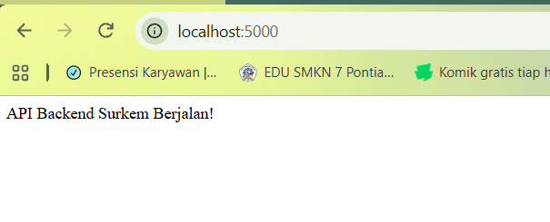


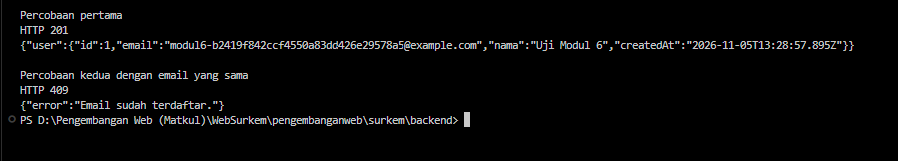

## 5. Transaksi dan Rollback

Relasi aplikasi memakai `SetNull`, sehingga penghapusan profil pada aplikasi
tidak menghasilkan error `RESTRICT`. Untuk mendemonstrasikan perilaku
`RESTRICT` sesuai instruksi modul tanpa mengubah skema produk, jalankan eksperimen
berikut di sesi `psql` lokal. Tabel yang digunakan adalah tabel sementara dan
tidak menghapus data aplikasi.

### Siapkan tabel uji sementara

```sql
CREATE TEMP TABLE m6_profile (
  id INTEGER PRIMARY KEY,
  nama TEXT NOT NULL
);

CREATE TEMP TABLE m6_report (
  id INTEGER PRIMARY KEY,
  profile_id INTEGER NOT NULL,
  CONSTRAINT m6_report_profile_fk
    FOREIGN KEY (profile_id)
    REFERENCES m6_profile(id)
    ON DELETE RESTRICT
);

INSERT INTO m6_profile (id, nama) VALUES (1, 'Profil Uji');
INSERT INTO m6_report (id, profile_id) VALUES (1, 1);
```

### Uji delete tanpa transaksi eksplisit

```sql
DELETE FROM m6_profile WHERE id = 1;
-- Diharapkan gagal dengan SQLSTATE 23503 karena masih direferensikan.

SELECT * FROM m6_profile;
SELECT * FROM m6_report;
```

Delete yang gagal bersifat atomik: row induk dan row anak tetap ada.

### Uji rollback dengan savepoint

```sql
BEGIN;
SAVEPOINT sebelum_delete;

DELETE FROM m6_profile WHERE id = 1;
-- Diharapkan gagal dengan SQLSTATE 23503.

ROLLBACK TO SAVEPOINT sebelum_delete;
SELECT * FROM m6_profile;
SELECT * FROM m6_report;
ROLLBACK;
```

Setelah `ROLLBACK TO SAVEPOINT`, transaksi dapat dilanjutkan dan kedua row
seharusnya masih ada. `ROLLBACK` terakhir membatalkan sisa transaksi. Bila
menggunakan transaksi Prisma untuk operasi aplikasi, gunakan `$transaction`;
eksperimen SQL di atas khusus untuk menunjukkan constraint dan rollback.

Verifikasi lagi isi tabel sementara:

```sql
SELECT * FROM m6_profile;
SELECT * FROM m6_report;
```


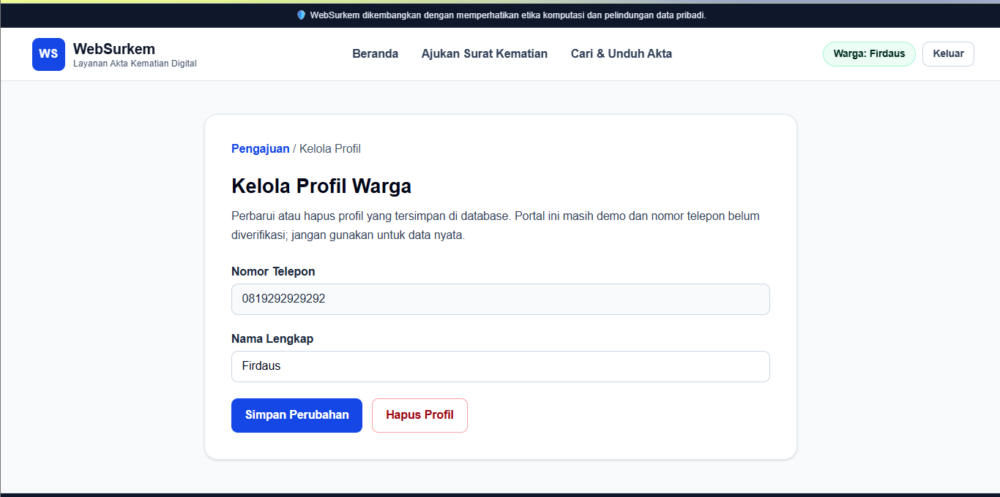
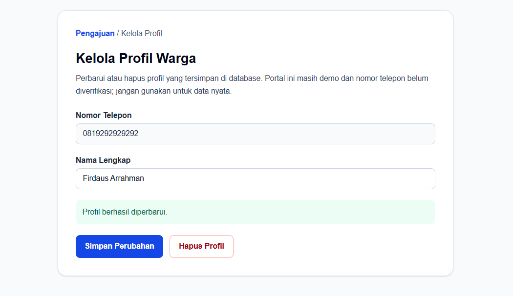
**Sebelumnya masih bernama Firdaus, setelah data di update maka apa yang diupdate akan etrubah di database**
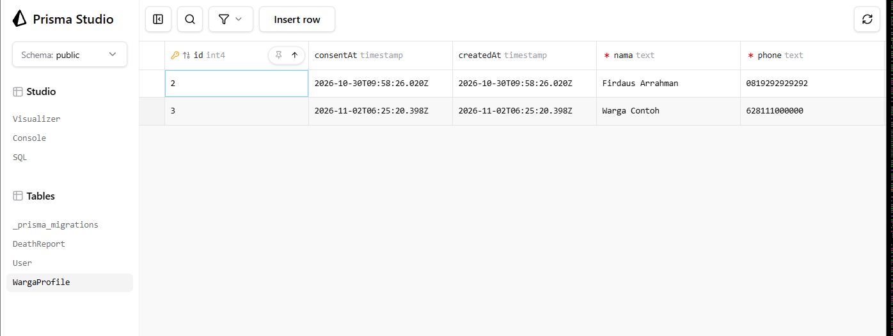
## 6. Skenario Uji

Jalankan skenario pada database lokal yang sudah dimigrasi. Isi hasil aktual
setelah mencoba sendiri; jangan menghitung skenario yang belum dijalankan sebagai
lulus.

| No. | Skenario | Hasil yang diharapkan | Hasil aktual | Bukti |
|---:|---|---|---|---|
| 1 | Jalankan `npx prisma validate` dari `backend` | Skema dinyatakan valid | Sudah Diuji | 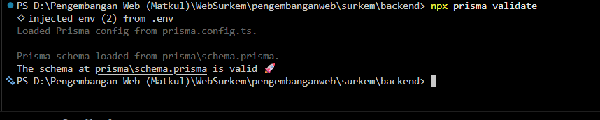 |
| 2 | Jalankan `npm run db:generate` | Prisma Client berhasil dibuat | Sudah diujin | 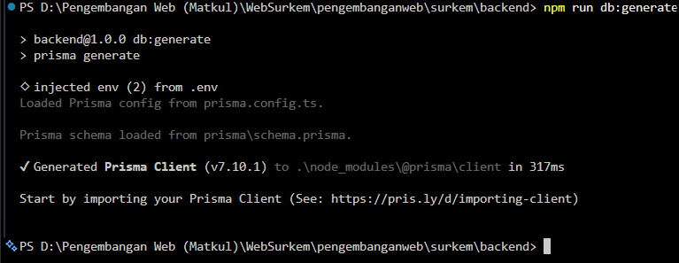 |
| 3 | Jalankan `npm run db:migrate` | Migration berhasil diterapkan; tabel dan foreign key tersedia | Sudah  diuji | 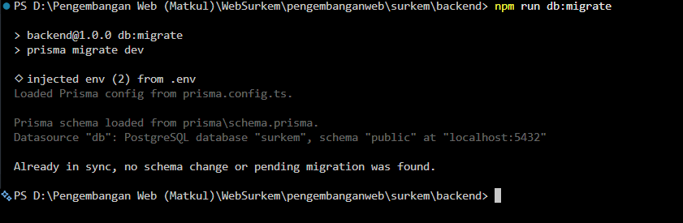 |
| 4 | Jalankan `npx prisma db seed` dua kali | Kedua proses berhasil; masing-masing record contoh tetap berjumlah satu | sudah  diuji | 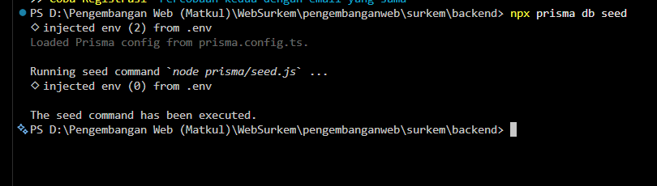 |
| 5 | Buat profil warga, lalu buka ulang/refresh halaman profil | Profil terbaca kembali dari PostgreSQL | Sudah diuji | 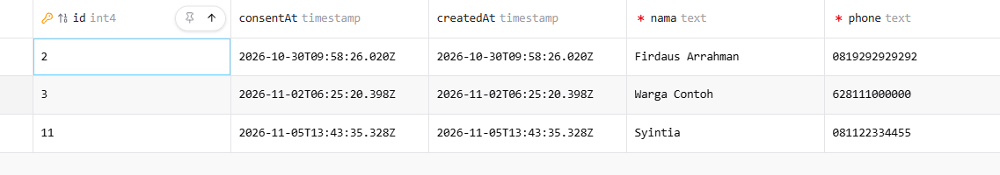 |
| 6 | Ubah nama profil, simpan, lalu refresh | Nama baru tetap tersimpan; nama kosong ditolak | Sudah diuji | 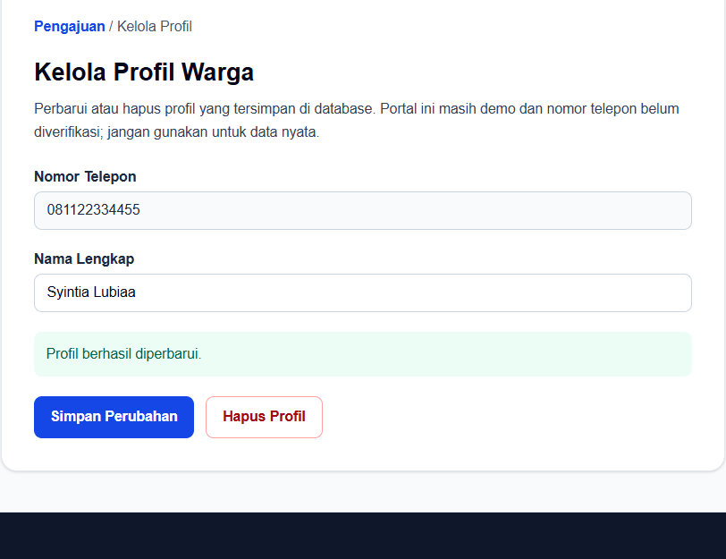 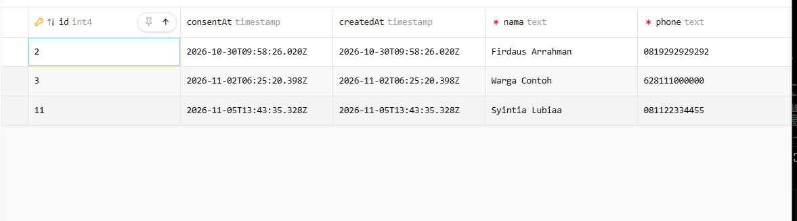 |
| 7 | Buat laporan menggunakan kontak profil warga | Laporan tersimpan dan `reporterProfileId` terhubung ke profil | Sudah diuji | 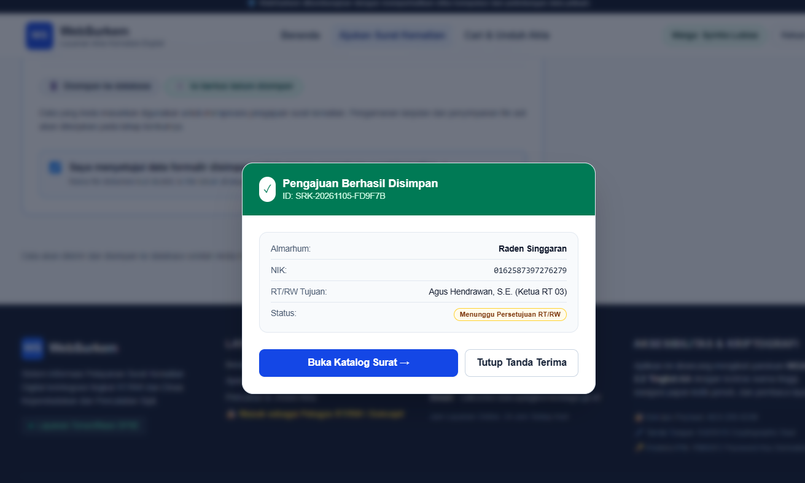 |
| 8 | Ubah status laporan melalui aksi petugas, lalu refresh dashboard | Status terbaca dan dikirim ke sang penguji| Sudah diuji | 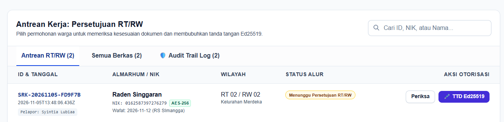|
| 9 | Meyetujui tanda tangan  | surat berhasil disetujui | Sudah diuji | 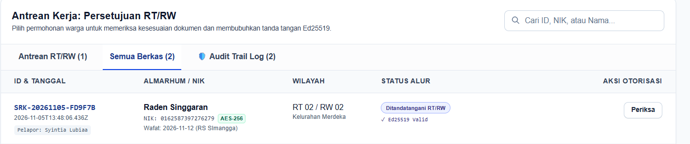 |
| 10 | Melihat tampilan persetujuan surat kematian  |menampilkan surat-surat yang akan diambil melalui enkripsi | Sudah diuji | 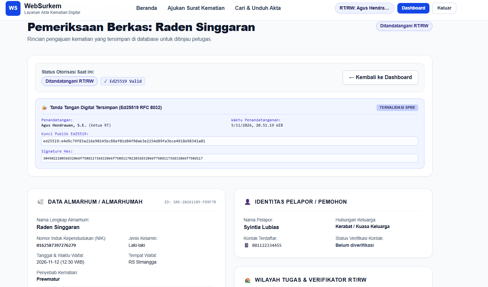|


## 7. Kendala dan Penyelesaian
Sejauh ini tidak ada

## 8. Catatan Pemanfaatan AI
Menggunakan bantuan AI gemini dan copilot untuk membantu menjawab dan membuat pada tugas kali ini dan disesuaikan dengan modul tugas yang diberikan
